  

  <b>Shop floor experience × software.</b> I turn what machines do every minute into numbers people can act on. 
  <i>مشین کی ہر دھڑکن کو ایسے نمبروں میں بدلنا جن پر فیصلہ ہو سکے</i>

  
  
  

---

## 🏭 Where I come from

I work in **automotive and home-appliance manufacturing** — the world of:

| | | |
|:--:|:--:|:--:|
| 🔩 **Presses & sheet metal** stamping, blanking, dies, changeovers | 🧱 **Mold making** tooling, tool life, repairs | 🔥 **Welding** spot, MIG, fixtures |
| ⚙️ **CNC & conventional machining** VMC, lathes, milling, EDM | 🛠️ **Maintenance** breakdowns, PM, spare parts | 📊 **Production** OEE, scrap, shift reports |

On a real shop floor the hard questions are simple: *Why did the line stop? How much did it cost? Did the fix actually work?*
That is what I am building software for.

---

## 🚀 Building: OEEnova

  

**OEEnova** is a machine & production intelligence platform for *every* machine type — not just pumps and motors, but presses, spot-weld robots, CNCs, paint lines, PU foam lines and the old lathe in the corner.

- 📈 **Live OEE** for every machine, line and shift
- 💸 **Loss Ledger** — every lost minute and scrap part counted once, in **PKR**
- 🧬 **Machine DNA** — 20 machine families with parts, sensors, failure modes and PM built in
- 🔔 **Alerts & reports on WhatsApp and e-mail**, with escalation
- 📱 **Operator tablet in Urdu** — two taps, works offline
- 🔒 **Private by design** — each company sees only its own plants, enforced inside the database

<b>🗺️ Build progress</b> (updated 30 Oct 2026)

| Milestone | What | Status |
|---|---|---|
| M0 | App shell, Urdu + English, OEE engine (golden test) | ✅ Done |
| M1 | Private database, login, 11 roles, row-level security, audit log | ✅ Done |
| M2 | Organization, machines, QR labels, Excel import · Machine DNA, simulator | 🟡 In progress |
| M3 | Live OEE, shift calendar (namaz, Jumma, Ramzan), TV mode | ⏳ Next |
| M4 | Loss Ledger, operator tablet, andon · alerts on WhatsApp / e-mail | ⏳ |
| M5–M10 | Edge gateway, maintenance, tooling & quality, predictive, AI copilot, plant pilot | ⏳ |

The product code is private while it is built for its first customer in Karachi.

---

## 🧰 Tools I build with

  
  
  
  
  
  
  
  

**Shop-floor methods:** OEE / TEEP · TPM · SMED · 5-Why & fishbone · Kaizen · first-piece approval · PM planning

---

## 📂 Other work

| Project | |
|---|---|
| [**adnan-tenses**](https://github.com/adnanzafar313-afk/adnan-tenses) | 12 Tenses Mastery Tool — learn English tenses step by step |

---

  Every machine. Every cycle. Brighter. · ہر مشین، ہر سائیکل، نئی روشنی

